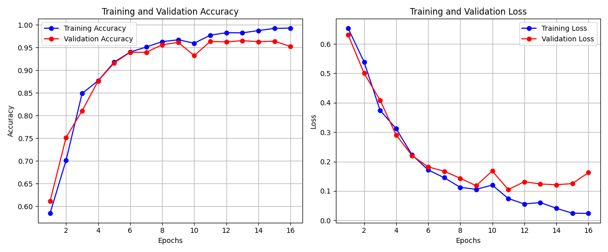

# Fake News Detection

A deep learning system that classifies news articles as real or fake, and explains
every verdict by highlighting the words that drove it.

The model is a CNN + LSTM trained on English news articles and tuned with Keras
Tuner. It is wrapped in a Streamlit web app that accepts typed, pasted or dictated
text and returns a verdict, a confidence score, and a LIME word-level explanation.



---

## Contents

- [Results](#results)
- [Quick start (Windows)](#quick-start-windows)
- [Manual install (any OS)](#manual-install-any-os)
- [Using the app](#using-the-app)
- [Project structure](#project-structure)
- [How it works](#how-it-works)
- [Retraining](#retraining)
- [Dataset](#dataset)
- [Troubleshooting](#troubleshooting)
- [Limitations](#limitations)
- [Licence](#licence)

---

## Results

Held-out test set, tuned CNN + LSTM:

| Split (train/val/test) | Accuracy | Precision (fake) | Recall (fake) | F1 (fake) | Test size |
| --- | ---: | ---: | ---: | ---: | ---: |
| 80 / 10 / 10 | **0.9754** | 0.98 | 0.96 | 0.97 | 1,790 |
| 70 / 15 / 15 | 0.9609 | 0.97 | 0.93 | 0.95 | 2,685 |

The 80/10/10 model is the one the app ships with
(`model/best_cnn_rnn_model.keras`). Full reports are in `model/*.txt`, with
confusion matrices and learning curves alongside them as PNGs.

Three other models are included for comparison: an untuned CNN + LSTM, and MLP
classifiers over TF-IDF features in both default and grid-searched form.

---

## Quick start (Windows)

Two files, and you only ever need the first one once.

1. **Double-click `SETUP.bat`.** It downloads a private Python 3.12 runtime,
   installs every dependency, fetches the NLTK language data, and verifies the
   install. Takes 5-10 minutes and needs an internet connection.
2. **Double-click `RUN.bat`.** The app starts and your browser opens at
   <http://localhost:8501>. Close the console window to stop it.

After the first setup, `RUN.bat` is all you need - including if you move or
re-download the project. Nothing is installed system-wide, no administrator
rights are required, and your own Python installation (if you have one) is left
completely alone.

Everything lives under `%LOCALAPPDATA%\FNDetect`:

```
FNDetect\rt\         the private Python 3.12 runtime
FNDetect\venv\       the virtual environment all packages install into
FNDetect\nltk_data\  the language corpora
```

Deleting that one folder undoes the setup completely.

`HOW_TO_RUN.txt` has the same instructions in more detail.

> The environment is installed outside the project folder on purpose.
> TensorFlow's wheel nests header files about 106 characters deep, and the
> Windows 260-character path limit makes them fail to extract when the install
> root is long.

---

## Manual install (any OS)

Requires Python 3.10-3.12. TensorFlow does not support 3.13.

Work in a virtual environment so these pinned versions cannot disturb anything
else on your machine:

```bash
python -m venv .venv
```

```bash
source .venv/bin/activate        # Windows: .venv\Scripts\activate
```

```bash
pip install -r requirements-app.txt
```

```bash
python verify_setup.py
```

`verify_setup.py` checks your Python version, every required package, the NLTK
corpora (downloading any that are missing), the cleaning pipeline and the saved
model - including a real prediction. It exits `0` when the app is ready. Run it
first: it turns a silent runtime failure into a one-line diagnosis.

```bash
streamlit run app.py
```

Use `requirements.txt` instead of `requirements-app.txt` if you also want to
retrain or work in notebooks; it is the full pinned environment.

On Linux and macOS, install the audio headers first if you want speech input:

```bash
sudo xargs apt install -y < packages.txt
```

Speech input is optional. Without PyAudio the Record button is simply disabled
and everything else works.

---

## Using the app

Paste a headline into **Article Title** and the body into **Article Body
Content**, then press **Analyze Article Integrity**. The body needs at least 20
words. The two sample buttons fill the form with example articles if you just
want to see it work.

You get back:

- a verdict with a confidence score,
- the article with influential words shaded - red pushed the prediction toward
  fake, blue toward real, with intensity showing relative strength, and the exact
  contribution on hover,
- ranked bar charts of the strongest evidence for each class,
- a downloadable Markdown report of the analysis.

The sidebar (the arrow at the top left) holds:

| Control | Effect |
| --- | --- |
| Model checkpoint | Switch between the saved models |
| Decision threshold | P(fake) at or above this is reported as misinformation. Lower it to catch more fakes at the cost of false alarms |
| Explain the prediction | Turn LIME off for a faster verdict |
| LIME samples | More samples give a steadier explanation but take longer |
| Enforce English-only input | The model is English-only; untick when language detection misfires on short or technical text |

Results stay on screen while you adjust the sidebar, and the last ten analyses
are kept in a session history panel.

The **Record** button dictates into the body field, appending to whatever is
already there. It is greyed out if no microphone is available.

---

## Project structure

```
SETUP.bat               One-time installer (private Python + dependencies)
RUN.bat                 Starts the app
HOW_TO_RUN.txt          Step-by-step guide

app.py                  Streamlit interface: inference + LIME explanations
preprocessing.py        Text cleaning pipeline and dataset builder
verify_setup.py         Environment and model health check
test.py                 Evaluate a saved model against a held-out split
fileconverter.py        Re-serialise a model for another platform

cnn+rnn.py              Hyperband-tuned CNN + LSTM (the deployed model)
basic_cnn+rnn.py        Untuned CNN + LSTM baseline
MLP/MLP_fine_tune.py    Grid-searched MLP over TF-IDF
MLP/MLP_Default.py      Default-hyperparameter MLP over TF-IDF

model/                  Saved model, confusion matrices, learning curves
LinuxEnv/               Model re-saved for Linux/Unix runtimes
MLP/MLP_Default/        Default MLP results
MLP/MLP_Fine_Tuned/     Tuned MLP model, vectoriser and results

0.2_split_data.joblib   80/10/10 train/validation/test split
0.3_split_data.joblib   70/15/15 train/validation/test split

requirements-app.txt    Runtime dependencies (used by SETUP.bat)
requirements.txt        Full pinned environment (training + notebooks)
```

---

## How it works

### Text cleaning

`preprocessing.py` defines the pipeline once, in `_TextCleaner.clean_tokens`, and
both the training path (`Preprocessing`) and the serving path
(`InferencePreprocessor`) use it. Keeping a single implementation matters: if the
two ever diverged, the model would silently be fed a different token distribution
than it was trained on and accuracy would quietly collapse.

The order is fixed and must not be changed:

1. `ftfy` repairs mojibake
2. contractions expanded, before lowercasing
3. lowercase
4. URLs and HTML tags stripped
5. word tokenisation
6. POS tagging
7. keep ASCII alphabetic non-stop-words, then POS-aware lemmatisation

Negations (`not`, `never`, `no`, ...) are deliberately kept even though NLTK
lists them as stop words, because they carry the polarity of a claim - "no
evidence" and "evidence" should not clean down to the same token.

### Model

Title and body are concatenated, cleaned, then fed through a Keras
`TextVectorization` layer (5,000-word vocabulary, 500-token sequences) into an
embedding, one to three Conv1D blocks with pooling between them, an LSTM, a dense
layer and a sigmoid output. Dropout sits after the embedding and the dense layer.

Keras Tuner's Hyperband searches embedding size, number and width of conv blocks,
kernel size, LSTM units, dense units, activations, dropout rate and learning rate.
The architecture follows the approach described in
[this paper](https://www.sciencedirect.com/science/article/pii/S2667096820300070).

Label `1` means fake, so the sigmoid output is read directly as P(fake).

### Explanations

LIME perturbs the cleaned document, re-scores each variant, and fits a local
linear model to find which words mattered. Those features come back lemmatised,
so the app maps them back onto the surface forms in the original article - the
feature `insider` highlights "insiders", `admit` highlights both "ADMIT" and
"admitted".

---

## Retraining

The splits are committed, so you can retrain without the raw corpus.

**Train:**

```bash
python cnn+rnn.py
```

```bash
python basic_cnn+rnn.py
```

```bash
cd MLP && python MLP_fine_tune.py
```

```bash
cd MLP && python MLP_Default.py
```

The MLP scripts resolve paths relative to `MLP/`, so run them from inside that
directory.

**Evaluate any saved model:**

```bash
python test.py --model model/best_cnn_rnn_model.keras --data 0.2_split_data.joblib
```

```bash
python test.py --model MLP/MLP_Fine_Tuned/mlp_fake_news_model.pkl --vectorizer MLP/MLP_Fine_Tuned/tfidf_vectorizer.pkl
```

**Rebuild the splits** (only needed if the corpus or the cleaning changes):

```bash
python preprocessing.py
```

A few notes on the training code, since each one is easy to get wrong:

- `cnn+rnn.py` lets Hyperband control the per-trial epoch budget. Passing a fixed
  `epochs` to `tuner.search()` overrides the bracket schedule and makes every
  trial run the full budget, which defeats the point of Hyperband.
- The MLP scripts early-stop on the **validation** split. Early-stopping on the
  test split leaks it into model selection and inflates the reported numbers.
- ROC and AUC are computed from predicted **probabilities**, not thresholded
  labels. Hard 0/1 labels collapse the curve to three points and understate the
  model.

---

## Dataset

The processed train/validation/test splits are included as `.joblib` files, so
the app and the training scripts run out of the box.

The raw corpus is not committed. To rebuild the splits yourself, place a
`fake_news.csv` next to `preprocessing.py` with these columns:

| Column | Meaning |
| --- | --- |
| `id` | Row identifier (dropped) |
| `title` | Headline |
| `author` | Author (dropped) |
| `text` | Article body |
| `label` | `1` = fake, `0` = real |

`preprocessing.py` drops nulls and duplicates, filters to English with
`langdetect`, cleans every document, and writes stratified splits. `test_size` is
held out and then halved into validation and test, so `0.2` yields an 80/10/10
partition.

The class balance is roughly 53% real to 47% fake, so no resampling is applied.

---

## Troubleshooting

| Symptom | Cause and fix |
| --- | --- |
| Anything at all goes wrong on Windows | Run `SETUP.bat` again. It is safe to re-run, resumes where it stopped, and ends with a full diagnosis |
| `DLL load failed ... An Application Control policy has blocked this file` | **Windows Smart App Control** is blocking TensorFlow, whose native libraries are unsigned. Re-running `SETUP.bat` usually clears it, because the freshly installed files get re-evaluated. If it persists, turn Smart App Control off: Windows Security &rarr; App & browser control &rarr; Smart App Control settings &rarr; **Off** — but note it cannot be switched back on afterwards without reinstalling Windows, so decide deliberately. Confirm it is the cause by looking for Event ID 3077 in Event Viewer under *Applications and Services Logs &rarr; Microsoft &rarr; Windows &rarr; CodeIntegrity &rarr; Operational* |
| `DLL load failed ...` with no further detail (WinError 1114) | Usually the same Smart App Control block reported generically. If Smart App Control is already off, it is the other known cause: TensorFlow 2.19+ ships a separate ~944 MB `_pywrap_tensorflow_common.dll` that fails to initialise on some machines. `requirements-app.txt` pins 2.17.1, which does not have that split. Do not upgrade TensorFlow to fix this - upgrading is what causes it |
| `LookupError: averaged_perceptron_tagger_eng` | NLTK corpora missing. Run `python verify_setup.py`, which downloads them |
| `pip install -r requirements.txt` fails to parse | The file must be UTF-8. Some editors re-save it as UTF-16, which pip cannot read |
| Model file not found | Train a model, or pick a different checkpoint in the sidebar |
| Record button greyed out | No microphone, or PyAudio is not installed. Everything else still works |
| Unsupported language detected, on English text | `langdetect` misfires on short or technical text. Untick *Enforce English-only input* |
| Analysis is slow | Lower **LIME samples**, or untick **Explain the prediction** |

The two requirements files pin **different TensorFlow versions on purpose**.
`requirements-app.txt` uses 2.17.1 with numpy 1.26.4 because that combination
loads reliably on Windows; `requirements.txt` keeps 2.20.0. The saved model is a
Keras 3 archive and loads under both without conversion.

---

## Limitations

This tool provides automated assistance, not a verdict of fact. It was trained on
one English news corpus and reflects that corpus's conventions - it keys on
stylistic and lexical patterns, not on whether a claim is actually true.
Predictions can be confidently wrong on unfamiliar topics, satire, translated
text, or writing styles absent from the training data.

Always corroborate important claims against primary sources.

---

## Licence

Released under the MIT Licence. See [LICENSE](LICENSE).
